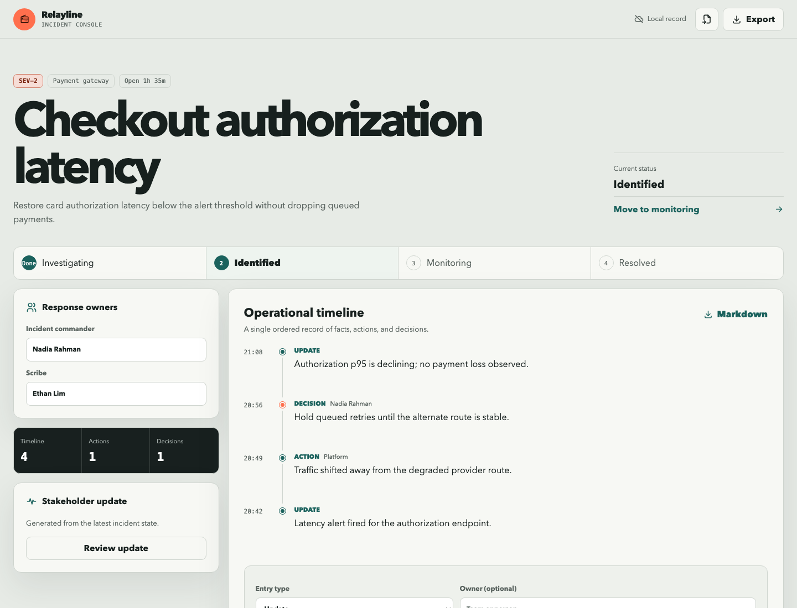
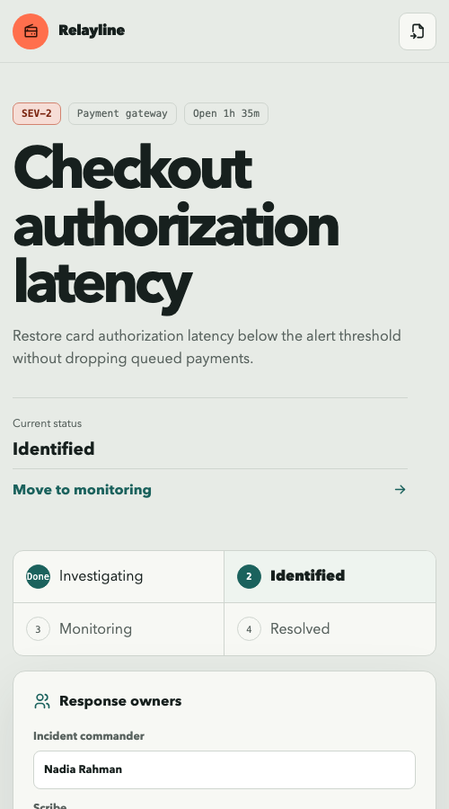

# Relayline Incident Console



Relayline is an offline-first incident command console for small engineering teams. It keeps the response objective, owners, lifecycle stage, operational timeline, and stakeholder update in one durable browser record, even when the network or the rest of the toolchain is degraded.

## Why this project exists

During an incident, teams often split the truth across chat, documents, dashboards, and memory. Relayline gives the response a compact source of record. It is deliberately not another ticket tracker: the main job is to preserve chronology, clarify ownership, and move the incident forward without allowing ambiguous status jumps.

## Product flow

1. Open an incident with a title, affected service, severity, and objective.
2. Assign an incident commander and scribe.
3. Record updates, actions, and decisions in an ordered timeline.
4. Move through Investigating, Identified, Monitoring, and Resolved in sequence.
5. Review and copy a generated stakeholder update.
6. Export the complete incident as JSON or Markdown, or import a prior JSON record.

## Features

- Forward-only incident lifecycle rules
- Structured updates, actions, and decisions with optional owners
- Editable commander and scribe roles
- Derived response counts and stakeholder update draft
- JSON import/export and readable Markdown handoff
- Browser persistence with no account required
- Static application shell and service-worker caching for offline use
- Realistic payment-latency sample incident
- Empty, initial-loading, success, validation, clipboard-error, import-error, and resolved states
- Responsive command layout, visible focus states, semantic form labels, and reduced-motion support

## Technology

- Svelte 5 and SvelteKit 2
- TypeScript 6
- Static adapter and Service Worker API
- Tabler Icons
- Vitest, Svelte Check, ESLint 10, and Prettier
- GitHub Actions CI

## Architecture

```text
Svelte command interface
    |
    +--> incident lifecycle domain (src/lib/incident.ts)
    |       +--> transition guards
    |       +--> timeline mutation
    |       +--> stakeholder update
    |       +--> Markdown export
    |
    +--> localStorage / JSON import-export
    |
    +--> SvelteKit static build
            +--> cached application shell
            +--> network fallback to cached root
```

Domain transitions and export formatting are plain TypeScript, independent from Svelte. The app can therefore test response rules without a browser, while the service worker handles offline availability as a separate boundary.

## Setup

Requirements: Node.js 22 or newer and npm 10 or newer.

```bash
git clone https://github.com/Decker7/relayline-incident-console.git
cd relayline-incident-console
npm install
npm run dev
```

## Commands

| Command                | Purpose                                                |
| ---------------------- | ------------------------------------------------------ |
| `npm run dev`          | Start the SvelteKit development server                 |
| `npm run build`        | Generate the production static site and service worker |
| `npm run preview`      | Serve the production build locally                     |
| `npm test`             | Run lifecycle and export tests once                    |
| `npm run lint`         | Run ESLint with zero warnings allowed                  |
| `npm run typecheck`    | Run Svelte and TypeScript diagnostics                  |
| `npm run format`       | Format the repository                                  |
| `npm run format:check` | Verify formatting without edits                        |

## Verification

The release was checked with:

```bash
npm run format:check
npm run lint
npm run typecheck
npm test
npm run build
npm audit --omit=dev
```

Current test suite: 5 passing lifecycle tests and zero Svelte diagnostics. The rendered production experience scored 100 for Performance, Accessibility, and Best Practices in a local Lighthouse audit.

## Responsive preview



## Privacy and security

- Incident data stays on the current device unless explicitly exported.
- The app has no accounts, analytics, network API, or credentials.
- Imported JSON is checked for required incident fields and supported lifecycle values.
- The service worker caches only same-origin static application resources.

## Limitations

- Relayline manages one active local incident at a time.
- It does not provide realtime multi-user collaboration, paging, integrations, or server-backed audit immutability.
- Clearing site data removes the browser record. Export important incidents.
- Offline behavior begins after the first successful production visit and depends on browser service-worker support.

## Future opportunities

- Encrypted multi-incident archive
- Optional WebRTC peer-to-peer room for local incident teams
- Status-page, pager, and chat integrations
- Timestamp correction and event amendment history
- Post-incident review builder derived from the timeline
- Cryptographic export signatures for audit-sensitive environments

## License

[MIT](LICENSE)
